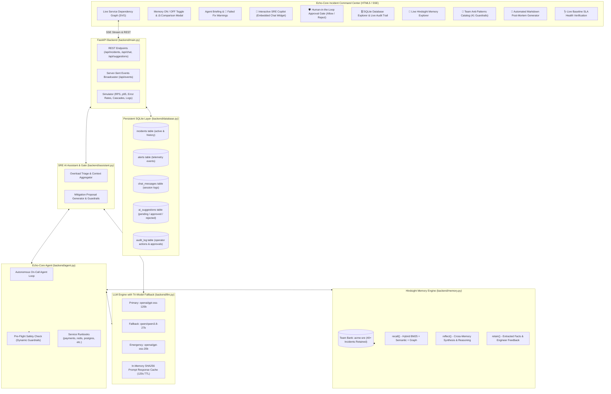

# Echo-Core: Incident Response Agent with Persistent Memory & AI Approval Gate
> **HackwithBengaluru 2.0** — Autonomous on-call incident response agent powered by **Hindsight persistent memory**, **Groq tri-model fallback LLMs**, **SQLite persistence**, and a **Human-in-the-Loop AI Approval Gate**.

---

## 1. Overview & Vision
In modern distributed systems, on-call engineers suffer from **institutional amnesia**:
- The same root causes recur across deployments (e.g. database connection pool exhaustion after Friday releases).
- Different engineers repeatedly attempt the **same failed fixes**, triggering secondary catastrophic outages (e.g. restarting pods during pool saturation triggers an immediate connection stampede that crashes the database).
- Historical knowledge is scattered across old Slack threads, resolved Jira tickets, or lost entirely when team members transition.

**Echo-Core** solves this with **biomimetic memory** and **safe autonomous orchestration**:
1. **Persistent Memory (Vectorize Hindsight)**: Remembers 40+ historical incidents, symptoms, error signatures, root causes, working fixes, and critically: **fixes that FAILED**.
2. **SQLite Database Persistence (`echo_core.db`)**: Persists all incident lifecycles, alerts, chat conversations, and an immutable audit trail across server restarts.
3. **Interactive SRE AI Copilot**: A real-time conversational assistant providing overload advice and cascade triage.
4. **Human-in-the-Loop Approval Gate**: When AI formulates a mitigation action, it is staged with an explicit **"Allow" (Execute)** and **"Reject"** decision gate. The agent **never executes** until authorized by an engineer.

---

## 2. Architecture Diagram



---

## 3. How the Approval Gate Works (Human-in-the-Loop)

To prevent AI hallucinations or unintended production disruptions, Echo-Core enforces a strict **Approval Gate Engine**:

1. **AI Synthesis**: During an incident overload, the SRE Copilot or Agent analyzes the alert, recalls past incidents, and formulates a remediation action (e.g. tuning connection pools, scaling replicas, or adjusting rate limiters).
2. **Staged Proposal**: The action is converted into a structured `ai_suggestions` record with status `pending`.
3. **Interactive Decision Card**: The card is rendered inside the SRE Copilot chat and the top **🛡️ Approvals** modal with:
   - Action Title & Target Service
   - Risk Assessment (`LOW`, `MODERATE`, `HIGH`, `CRITICAL`)
   - Exact CLI/kubectl command preview
   - Historical reasoning and safety explanation
   - **`[ ✅ Allow (Execute) ]`** and **`[ ❌ Reject ]`** buttons.
4. **Execution on Approval Only**:
   - The command is **never executed** until the operator explicitly clicks **Allow**.
   - Upon clicking **Allow**, the backend validates pre-flight safety, runs the command, eases cluster telemetry back down, marks status `approved`, logs to the immutable `audit_log`, and notifies via SSE stream.
   - If the operator clicks **Reject**, status transitions to `rejected`, and the audit trail records the discard.

---

## 4. SQLite Database Persistence (`data/echo_core.db`)

Echo-Core provides complete operational durability across process restarts:
- **`incidents`**: Stores incident IDs, titles, root causes, agent briefings, and resolution feedback.
- **`alerts`**: Real-time event log of alerts raised by the monitoring engine.
- **`chat_messages`**: Persistent conversation history with the SRE Copilot.
- **`ai_suggestions`**: Comprehensive ledger of all AI proposed actions and operator approval decisions.
- **`audit_log`**: Tamper-evident trail tracking every command execution, resolution, and approval.

---

## 5. Prototype Testing & Demo Walkthrough Guide

Follow these steps to evaluate all core capabilities of Echo-Core:

### Step 1: Launch the Application
Run the one-click launcher:
```cmd
run.bat
```
*(Or `python -m uvicorn backend.main:app --host 0.0.0.0 --port 8000`)*. Open your browser at **`http://localhost:8000/`**.

### Step 2: Test the Interactive SRE Copilot
1. Click the **`🤖 SRE Copilot`** button in the bottom-right corner.
2. Click the quick chip: **"🔥 Overload Help"** or type:
   > *"Payments service is throwing 5xx errors. What should I do?"*
3. **Observe**: The Copilot analyzes current telemetry, checks team runbooks, identifies the connection pool bottleneck, and **stages an approval card**.

### Step 3: Test the Approval Gate ("Allow" vs "Reject")
1. In the chat message or by clicking **`🛡️ Approvals`** in the header, review the proposed mitigation card:
   - Notice the risk badge, proposed command (`kubectl patch ...`), and historical reasoning.
2. Click **`✅ Allow (Execute Action)`**:
   - Notice the card updates to `[ ✅ Approved & Executed by Sarah Chen ]`.
   - Notice the live p95 latency and error rate in the KPI panel ease down towards nominal baseline!
   - A confirmation toast appears and a system event is logged.

### Step 4: Test the Star Feature (Critical Warning on Failed Fix)
1. In the top toolbar, click **`Demo 20 (Failed Fix Warning)`**.
2. Expand the newly created `payments` incident.
3. Observe the bright red banner:
   > **🚨 CRITICAL: PREVIOUSLY FAILED FIX (DO NOT ATTEMPT)**: *Do NOT execute kubectl rollout restart deploy/payments. Restarting causes an immediate connection storm on Postgres!*
4. Click **`⚖️ Compare vs Generic`**: See how naive zero-memory AI recommends restarting pods, while Echo-Core blocks it.
5. Click **`Restart service`** on payments: The modal warns you. If confirmed, the simulator models the catastrophic connection storm in real time!

### Step 5: Test Multi-Service Cascading Outage
1. Click **`Cascade Outage`** in the header.
2. The simulator triggers a 4-service cascade (`payments` -> `postgres` -> `orders` -> `api-gateway`).
3. Echo-Core analyzes the dependency chain and pinpoints `payments` as the root cause.
4. Ask the Copilot: *"Triage cascade root cause and suggest mitigation"*.

### Step 6: Verify Database Persistence & Audit Trail
1. Click the **`🗄️ Database & Audit`** button in the header.
2. Inspect the counters: Total Incidents, Alerts Persisted, Chat Messages, and Audit Events.
3. Scroll through the Audit Trail to see timestamped entries of every command, suggestion approval, and incident resolution.
4. Restart the server and reload: all incident states and audit logs remain intact!

---

## 6. Automated Test Suite (23 Tests)

Run the automated test suite verifying memory, database, LLM fallback, and approval gate:
```cmd
python tests/run_tests.py
```
**Output:**
```
======================================================================
  [SUCCESS] All test suites PASSED in 183.80s!
  * Memory Layer:        VERIFIED (Hindsight Bank acme-sre)
  * LLM & Agent Loop:    VERIFIED (Groq openai/gpt-oss-120b)
  * SQLite Persistence:  VERIFIED (echo_core.db & Audit Trail)
  * SRE Copilot & Chat:  VERIFIED (Interactive Assistant)
  * Approval Gate Sys:   VERIFIED (Human-in-the-Loop Allow/Reject)
  * FastAPI Endpoints:   VERIFIED (REST, SSE, Cascade)
  * Safety Pre-Flight:   VERIFIED (Anti-Patterns Guardrails)
======================================================================
```

---

## 7. Directory Structure
```
MIC2/
├── run.bat                      # Windows one-click batch launcher
├── start.bat                    # Alias batch launcher
├── pyproject.toml               # Package config & Vercel deployment spec
├── requirements.txt             # Python dependencies
├── README.md                    # System documentation & testing guide
├── backend/
│   ├── config.py                # Configuration & environment paths
│   ├── database.py              # SQLite persistence layer (incidents, chat, suggestions, audit)
│   ├── assistant.py             # SRE AI Copilot & Approval Gate Engine
│   ├── memory.py                # Hindsight client wrapper (retain, recall, reflect, search)
│   ├── llm.py                   # Groq LLM with tri-model fallback chain & SHA256 cache
│   ├── agent.py                 # Incident response agent with 41 anti-pattern guardrails
│   ├── simulator.py             # Telemetry engine, cascade simulator, command executor
│   └── main.py                  # FastAPI REST + SSE endpoints
├── data/
│   └── seed_incidents.json      # 45 historical incident records with failed fixes
├── frontend/
│   └── sentinelops.html         # Full incident command center dashboard
└── tests/
    ├── run_tests.py             # Automated test runner
    ├── test_database.py         # SQLite persistence & audit tests
    ├── test_chat_suggestions.py # Copilot & approval gate tests
    ├── test_agent.py            # Agent briefing & safety tests
    ├── test_api.py              # REST & SSE API tests
    └── test_memory.py           # Hindsight memory tests
```

---

*Built with ❤️ for HackwithBengaluru 2.0.*
