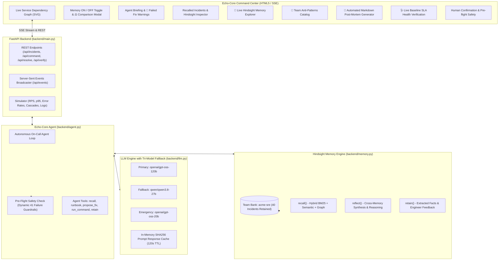

# Echo-Core: Incident Response Agent with Persistent Memory
> **HackwithBengaluru 2.0** — Autonomous on-call incident response agent powered by **Hindsight persistent memory** and **Groq LLMs**.

---

## 1. Overview & Vision
In modern distributed systems, on-call engineers suffer from **institutional amnesia**:
- The same root causes recur across deployments (e.g. database connection pool exhaustion after Friday releases).
- Different engineers repeatedly attempt the **same failed fixes**, triggering secondary catastrophic outages (e.g. restarting pods during pool saturation triggers an immediate connection stampede that crashes the database).
- Historical knowledge is scattered across old Slack threads, resolved Jira tickets, or lost entirely when team members transition.

**Echo-Core** solves this with **persistent biomimetic memory**. Using **Vectorize Hindsight**, Echo-Core remembers every past incident: symptoms, error signatures, root causes, working fixes, historical resolvers, and critically: **fixes that FAILED**. With every resolved incident, Echo-Core gets measurably smarter.

---

## 2. Architecture Diagram



---

## 3. How Hindsight Memory is Used

Echo-Core uses the official Python `hindsight-client` and leverages the three core operations of Vectorize Hindsight:

### 1. `recall()` — Multi-Strategy Hybrid Retrieval
When an alert fires, Echo-Core executes parallel hybrid search across the team memory bank (`acme-sre`) combining:
- **Semantic Vector Similarity**: Matches natural language descriptions and symptoms.
- **BM25 Keyword Matching**: Matches exact error codes, stack traces, and service names.
- **Entity & Temporal Links**: Resolves services, deployments, and previous timeline occurrences.

### 2. `reflect()` — Autonomous Reasoning & Synthesis
Rather than dumping raw text into the LLM prompt, Hindsight’s `reflect()` runs an autonomous synthesis loop over accumulated memories to answer:
1. *What is the likely root cause based on past patterns?*
2. *What fix worked previously?*
3. 🚨 ***CRITICAL: What fixes FAILED in the past and MUST NOT be attempted?***
4. *Who solved this in the past?*

### 3. `retain()` — Learning from Resolution Feedback
When the on-call engineer mitigates an incident, Echo-Core prompts for resolution notes, rating, and whether the suggestion worked. The entire incident record, remediation commands, and engineer feedback are ingested via `retain()`. Hindsight’s extraction pipeline automatically parses the facts, linking them to the service and team graph.

### 4. Memory ON / OFF Comparison: The Stark Contrast
Echo-Core computes both a **Memory-Informed Briefing** and a **Generic (Memory OFF) Briefing**:
- **With Memory OFF**: A naive LLM generates textbook advice: *"Restart the pods with `kubectl rollout restart deploy/payments`"*.
- **With Memory ON**: Echo-Core explicitly warns: *"🚨 DO NOT restart payments pods! In INC-1001, restarting caused an immediate connection stampede that brought down Postgres for 18 minutes. Apply PgBouncer pooler patch instead."*

---

## 4. Key Features & Improvements (Part 1 & Part 2)

### Part 1: Core Agent & Persistent Memory
- **Full Memory Ingestion**: 40 realistic historical incidents ingested into Hindsight bank `acme-sre` across 9 microservices.
- **Side-by-Side Comparison Modal (`⚖️ Compare vs Generic`)**: Directly displays the risk delta between generic LLM advice and memory-backed advice.
- **Pre-Flight Safety Checks**: The agent verifies proposed commands against known anti-patterns before presenting them to the engineer.
- **Human-in-the-Loop Safeguards**: Mutating commands require typing the target service name to confirm.
- **Catastrophic Failure Simulation**: If the user overrides the warning and restarts payments, the simulator models the connection storm in real time.

### Part 2: Advanced Autonomous SRE Capabilities
- 🧠 **Interactive Hindsight Memory Explorer**: Directly query the team memory bank from the UI to inspect hybrid search results, extracted entities, and memory facts.
- 🚨 **Team Anti-Patterns Catalog**: Interactive modal displaying 41 documented historical mistakes and failed fixes across the infrastructure.
- 💥 **Multi-Service Cascading Outage Simulation**: Simulates a cascade (`payments` -> `postgres` -> `orders` -> `api-gateway`) where Echo-Core pinpoints the root cause service.
- 🔄 **Engineer Feedback & Rating Loop**: Allows rating mitigations and recording feedback, continuously enriching the memory bank.

---

## 5. Demo Scenarios (Step-by-Step)

The dashboard includes one-click buttons in the top toolbar:

| Scenario Button | Description | Memory State | Echo-Core Behavior |
| :--- | :--- | :--- | :--- |
| **Demo 1 (Cold Start)** | GPU threadpool memory fragmentation on `ml-ranker` | Novel / Empty | Zero-shot diagnosis; provides generic debugging advice and retains outcome upon resolution. |
| **Demo 5 (Pattern Match)** | Redis OOM eviction storm on `auth` | Matched `INC-1002`/`INC-1014` | Recalls past eviction incident; recommends switching to `volatile-lru` and cites **Alex Mercer (Principal Infra)**. |
| **Demo 20 (Failed Fix Warning)** | Postgres connection pool exhaustion on `payments` | Matched `INC-1001` & `INC-1020` | **Star of the Demo:** Identifies Friday deploy pattern. Issues **CRITICAL WARNING** against restarting pods. If the engineer runs restart anyway, the simulator demonstrates the catastrophic stampede! |
| **Cascade Outage** | Multi-service failure cascade | Topology-wide | Echo-Core analyzes the dependency chain and pinpoints `payments` as the root cause. |

---

## 6. Quick Start Instructions

### Windows (One-Click)
Simply double-click or run from command prompt:
```cmd
run.bat
```
*(Or `start.bat`)*. This will verify dependencies, launch the default web browser to `http://localhost:8000/`, and start the FastAPI server with live SSE streaming.

---

### Manual Setup (Cross-Platform)

1. **Clone & Setup Virtual Environment**:
   ```bash
   python -m venv venv
   source venv/bin/activate  # On Windows: venv\Scripts\activate
   pip install -r requirements.txt
   ```

2. **Configure Environment Variables**:
   Copy `.env.example` to `.env` and fill in your keys:
   ```bash
   cp .env.example .env
   ```
   ```env
   HINDSIGHT_BASE_URL=https://api.hindsight.vectorize.io
   HINDSIGHT_API_KEY=hsk_your_key_here
   GROQ_API_KEY=gsk_your_key_here
   HINDSIGHT_BANK_ID=acme-sre
   GROQ_MODEL=openai/gpt-oss-120b
   GROQ_FALLBACK_MODEL=qwen/qwen3.8-27b
   HOST=0.0.0.0
   PORT=8000
   ```

3. **Seed Historical Incidents into Hindsight**:
   ```bash
   python scripts/seed_memory.py
   ```

4. **Launch Echo-Core**:
   ```bash
   python -m uvicorn backend.main:app --host 0.0.0.0 --port 8000 --reload
   ```
   Open your browser at **`http://localhost:8000/`**.

---

## 7. Directory Structure
```
MIC2/
├── run.bat                      # Windows one-click batch launcher
├── start.bat                    # Alias batch launcher
├── requirements.txt             # Python package dependencies
├── .env.example                 # Template for required environment variables
├── .gitignore                   # Ignores .env, __pycache__, logs
├── README.md                    # Architecture & Hindsight usage guide
├── PLAN.md                      # Architecture blueprint & specifications
├── backend/
│   ├── __init__.py
│   ├── config.py                # Environment configuration
│   ├── memory.py                # Hindsight wrapper (retain, recall, reflect, search)
│   ├── llm.py                   # Groq client with model fallback & retry
│   ├── agent.py                 # Echo-Core agent loop with tools & safety checks
│   ├── simulator.py             # Telemetry & cascading incident state machine
│   └── main.py                  # FastAPI REST + Server-Sent Events (SSE)
├── data/
│   └── seed_incidents.json      # 40 realistic historical incidents with anti-patterns
├── scripts/
│   └── seed_memory.py           # Ingestion script into Hindsight bank
└── frontend/
    └── sentinelops.html         # Echo-Core incident command center dashboard
```

---

*Built with ❤️ for HackwithBengaluru 2.0.*
